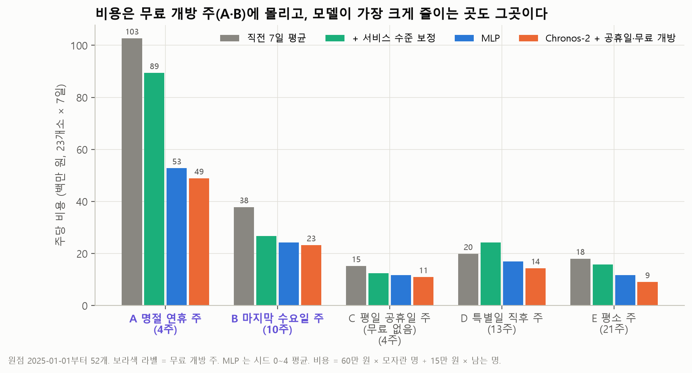
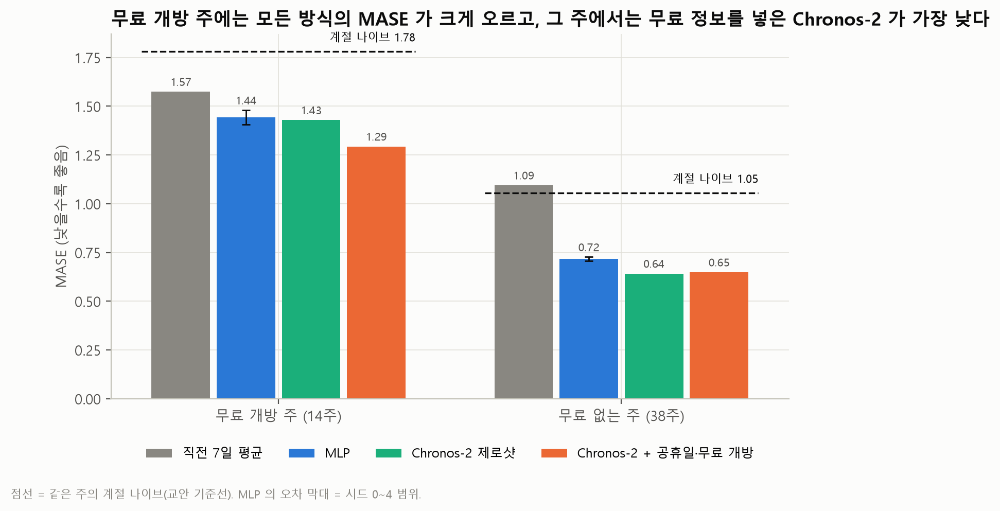
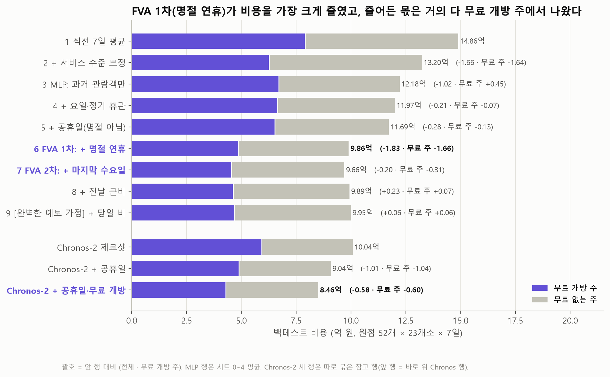
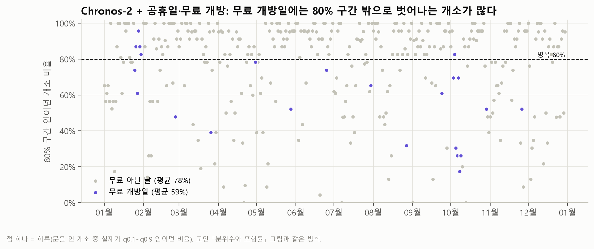
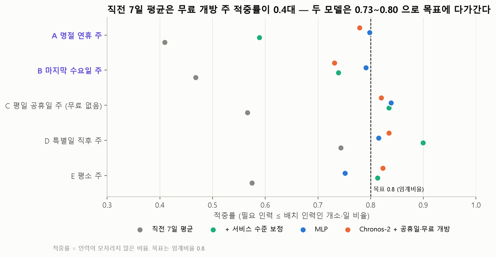
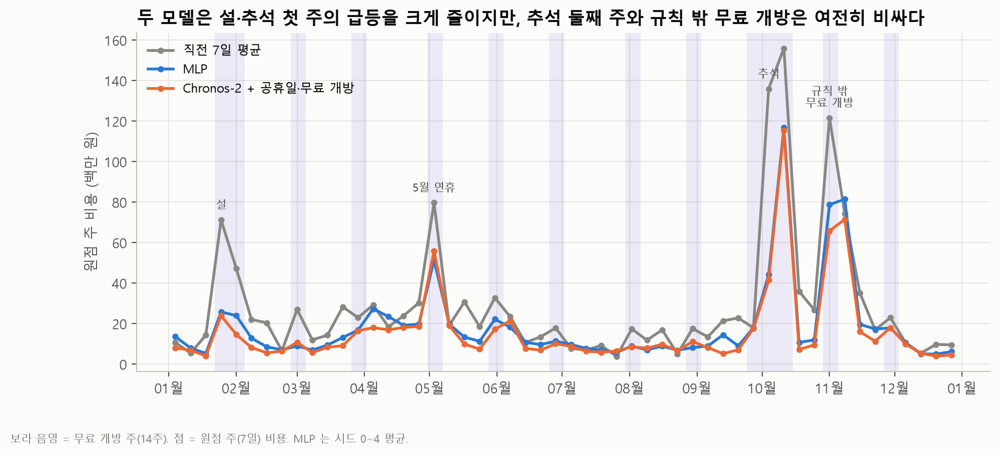
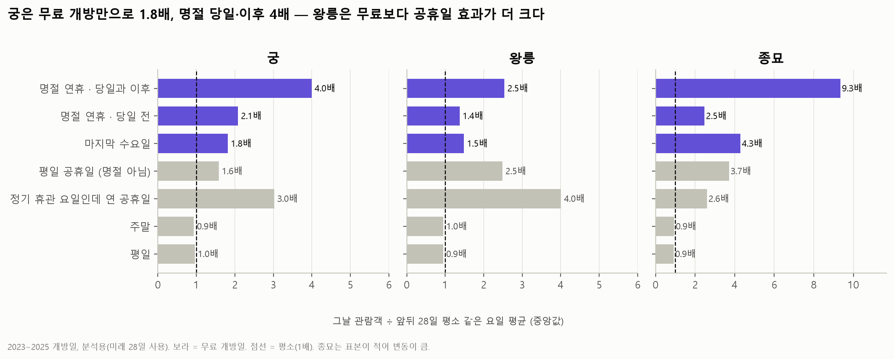

> real_final 판 — 본문의 파일 경로는 `real_final/` 기준이다(그림은 `report/figures/`).

# 궁·능 관람객 예측과 개소별 인력 배치 — 보고서 (초안)

**주제: 무료 개방일과 명절 연휴 — 「무료 개방일에 개소마다 인력을 평소의 몇 배로 늘려야 하는가」**

> 초안 상태: `⬜` 표시는 아직 하지 않은 항목이다. 숫자는 `appendix/run_v2/`(MLP, CPU), `appendix/run_v3/`(Chronos-2, Colab T4 — 로컬 CPU 재실행으로 같은 값 확인), `appendix/report_addons/`, `data/` 에서 나왔다. 이 폴더만으로 전부 다시 만들 수 있다: `python tools/run_all.py`. 확정(10/15): 최종 모형 C3 · 권고 4주 · 왕릉 하루 최소 1명.

---

## ① 권고 요약

**무료 개방일은 궁 기준 평소의 1.8배(마지막 수요일)~4배(명절 당일·이후)이고, 무료 개방 정보를 넣은 예측으로 인력을 정하면 2025년 백테스트 비용이 직전 7일 평균보다 6.40억 원(43%) 줄어든다.**

| 무엇을 | 값 |
|---|---|
| 핵심 질문의 답 (효과 크기) | 무료 개방만으로 궁 **1.8배**, 명절 연휴 당일·이후 **4.0배**, 종묘 마지막 수요일 **4.3배**. 단 왕릉은 무료 개방(1.5배)보다 무료 아닌 평일 공휴일(2.5배)이 더 크다 |
| 권하는 방법 | Chronos-2 에 공휴일·명절 연휴·마지막 수요일을 미래 입력으로 넣어 0.8 분위수 ÷ 2,000명으로 인력을 정한다 |
| 기본 가정 절감액 | 직전 7일 평균 14.86억 → **8.46억 (−6.40억)**. 그중 서비스 수준 보정만으로 −1.66억, 모형으로 −4.74억 |
| 팀 규칙(왕릉 하루 최소 1명) 적용 | 같은 규칙을 직전 7일 평균에도 적용하면 19.55억 → **14.05억 (−5.50억)** = 보정 −1.36억 + 모형 −4.13억. 왕릉에 남는 인원 비용이 생겨 두 방식 모두 비용이 오르지만 순위는 같다 |
| 무료 개방 주의 절감 | 주당 56.3 → 30.5백만 원 (−46%). 명절 연휴 주는 102.7 → 48.9백만 원 |
| 절감의 전제 | 모자란 1명·일 60만 원, 남는 1명·일 15만 원, 1명 = 하루 2,000명, 2025년 원점 52개 백테스트 |
| 근무표 확정 시점 | **4주 치를 2025-12-31 에 한 번에 내고, 매주 수요일 전날(화) 다음 1주를 다시 확정**한다. 한 번에 낸 4주의 2~4주차는 1~3주 일찍 확정한 것과 같아 비용이 8.46 → 9.22 · 9.44 · 9.30억(+0.76~0.98억)으로 늘지만, 3주 일찍 확정해도 직전 7일 평균(전날 확정 14.86억)보다 5.56억 적다. 근무자에게 일정을 한 달 전에 알려야 하면 4주 권고표를 그대로 써도 된다 |
| 운영팀 규칙 (한 문장) | 「명절 연휴 당일·이후 궁은 평소 같은 요일의 4배, 마지막 수요일 궁은 1.8배·종묘는 4배 이상을 기준으로 두고, 예측 모형의 0.8 분위수로 개소별 인원을 확정한다」 ← (가안) 모델이 배운 배수 확인 후 확정 |

**인력 배치 권고표 (2026-01-01 ~ 01-28, 4주)** — 2025-12-31 까지 자료로 C3(Chronos-2 + 공휴일·무료 개방)가 28일을 한 번에 예측했고, 날마다 0.8 분위수 ÷ 2,000명을 **올림한 정수**로 적었다. **왕릉은 문 여는 날 하루 1명 이상**(팀 규칙, 관리소 간 공유 없음). 정기 휴관일은 0명(이 4주엔 대체 휴관 없음). 무료 개방일은 1/28(마지막 수요일) 하루다. 개소 × 날짜 28일 표와 소수 인원·분위수는 `data/recommend_2026.csv`(`최종 권고 (정수)` · `최종 권고 (소수)`), 노트북 `notebooks/05_권고표_2026.ipynb`.

| 개소 | 1주차 01-01~07 | 2주차 01-08~14 | 3주차 01-15~21 | 4주차 01-22~28 | 4주 합 (명·일) | 1/21(수, 평소) | **1/28(수, 무료)** |
|---|---|---|---|---|---|---|---|
| 경복궁 | 54 | 43 | 45 | 47 | 189 | 8 | **10** |
| 창덕궁 | 17 | 15 | 14 | 13 | 59 | 2 | 2 |
| 창경궁 | 12 | 10 | 8 | 10 | 40 | 1 | **2** |
| 덕수궁 | 31 | 31 | 32 | 35 | 129 | 5 | **6** |
| 종묘 | 9 | 8 | 8 | 9 | 34 | 1 | **2** |
| 왕릉 18곳 (각) | 6 | 6 | 6 | 6 | 24 | 1 | 1 |
| **합계** | **231** | **215** | **215** | **222** | **883** | **35** | **40** |

1주차 일별 (명) — 2~4주차 일별 표는 `notebooks/05_권고표_2026.ipynb` 2절

| 개소 | 01-01(목, 신정) | 01-02(금) | 01-03(토) | 01-04(일) | 01-05(월) | 01-06(화) | 01-07(수) | 7일 합 |
|---|---|---|---|---|---|---|---|---|
| 경복궁 | 10 | 9 | 10 | 9 | 8 | 휴관 | 8 | 54 |
| 창덕궁 | 3 | 3 | 3 | 3 | 휴관 | 3 | 2 | 17 |
| 창경궁 | 2 | 2 | 2 | 2 | 휴관 | 2 | 2 | 12 |
| 덕수궁 | 5 | 5 | 6 | 5 | 휴관 | 5 | 5 | 31 |
| 종묘 | 2 | 1 | 2 | 2 | 1 | 휴관 | 1 | 9 |
| 왕릉 18곳 (각) | 1 | 1 | 1 | 1 | 휴관 | 1 | 1 | 6 |
| **합계** | **40** | **38** | **41** | **39** | **9** | **28** | **36** | **231** |

- 소수 인원 합 4주 449.6명·일, 왕릉 하한 1명을 반영하면 822.7명·일, 정수 합 **883명·일**. 정수가 소수보다 많은 몫의 대부분(432 − 58.9 = 373명·일)은 왕릉 최소 1명에서 나온다 — 왕릉의 필요 인원은 하루 0.0~0.4명이다.
- 1/28(마지막 수요일) 모형의 q0.8 은 1/21(평소 수요일)의 경복궁 1.30배 · 종묘 1.90배 · 창경궁 1.29배다. 과거 효과 크기(궁 1.8배)보다 작고, 백테스트에서도 마지막 수요일 적중률이 0.49 였으므로 **1/28 은 권고보다 더 필요할 수 있다**(⑤). 1 · 2 · 3주 일찍 확정해도 0.54 · 0.52 · 0.61 이라 4주차여서 낮은 것이 아니라, 어느 시점이든 실제가 중앙값의 약 1.5배인 무료 효과 과소 추정 때문이다.
- 3·4주차는 2·3주 일찍 확정한 백테스트(lead 15 · 22)로 검증했다: 적중률 0.80, 비용은 전날 확정보다 +0.98 · +0.84억.
- 1/1(신정)은 공휴일이지만 무료 개방일이 아니다(달력 규칙). ⬜ 2026-01-01 무료 여부 공지 확인.

---

## ② 질문과 범위

**개소 × 날짜 단위로 7일을 예측하고, 근무표는 원점 전날 확정하며, 1순위 지표는 WAPE 다.**

| 항목 | 정한 것 | 이유 |
|---|---|---|
| 예측 단위 | 개소(23곳) × 날짜 | 근무표가 개소마다 날짜별. 합계로 평가하면 개소 간 오차가 상쇄됨(실수 4번) |
| 예측 기간 | 7일 | 근무표 한 주 |
| 근무표 확정 | 원점 전날 (비교: 1주 전, ④) | 가이드 기본. 1주 전 확정보다 0.76억 싸다 |
| 원점 | 2025-01-01(수)부터 7일 간격 **52개** | 1년 전체 — 설·추석이 모두 시험됨. 첫날이 신정이라 2026-01-01 권고표와 같은 상황 |
| 1순위 지표 | **WAPE** (개소 × 날짜, 휴관일 제외) | 가이드 예시와 같은 지표. 큰 개소에 무게가 실려 비용의 무게와 같은 방향 |
| 보조 지표 | MASE(모델 비교), 비용(최종 결정), 적중률(목표 0.8), 80% 포함률 | 아래 표 |
| 채점 범주 | **무료 개방 주 O(14) / X(38)**, 2단 A~E | 비용이 공휴일이 아니라 무료 개방에 몰림(③ 참고) |

**지표마다 맡은 일**

| 지표 | 쓰는 곳 | 왜 |
|---|---|---|
| WAPE | 1순위 평가 지표 | 가이드 요구사항 1 |
| MASE | 학습 모델끼리 비교, 시드 범위 판정 | 23개소를 같은 무게로 봄 — WAPE 로는 직전 7일 평균이 계절 나이브보다 낫지만 23곳 중 12곳은 반대 |
| 비용(원) | 모형·서비스 수준·확정 시점의 최종 결정 | WAPE 는 대칭(많게·적게 같은 벌점), 비용은 모자랄 때 4배. WAPE 가 같아도 비용은 다름: 직전 7일 평균과 보정판 WAPE 0.444 로 같지만 비용 14.86 vs 13.20억 |
| 적중률 · 포함률 | 0.8 분위수가 실제 0.8 인지 확인 | 교안 임계비율·포함률 규칙 |

**해석이 갈리는 요구사항에서 택한 해석**

- 휴관일: `sites.csv` 정기 휴관 요일 기준, 실제로 문 연 날은 개방일. 규칙 밖의 0 은 **대체 휴관**(공휴일 개방 뒤 옮겨 쉰 날, 달력으로 앎)과 **임시 휴관**(공지로만 앎)으로 나누고 **둘 다 학습·평가에서 뺐다(A안)**. 시험 구간의 임시 휴관은 11 개소·일뿐이다.
- 무료 개방일(예측용): 달력 규칙 = 명절 연휴(설·추석 당일을 포함해 이어지는 휴일 전체) + 매월 마지막 수요일. `paid` 값은 쓰지 않는다(⑤ 실수 측정).
- 날씨: 2026 권고표에는 쓸 수 없으므로 원점 전날까지의 실측만 쓰고, 당일 비는 「완벽한 예보 가정」 행에만 쓴다.

---

## ③ 선택과 이유

**최종 모형은 Chronos-2 + 공휴일·무료 개방이고, 인력은 관람객 분포의 0.8 분위수 ÷ 2,000명이다.**

### 왜 무료 개방 O / X 로 채점하나

비용이 큰 주는 「공휴일 있는 주」가 아니라 「무료 개방 주」다 (직전 7일 평균, 주당 비용).

| 주 범주 | 원점 수 | 주당 비용 | 평소 주 대비 |
|---|---|---|---|
| A 명절 연휴 주 (무료) | 4 | 102.7백만 원 | 5.7배 |
| B 마지막 수요일 주 (무료) | 10 | 37.8백만 원 | 2.1배 |
| C 평일 공휴일 주 (무료 없음) | 4 | 15.2백만 원 | 0.8배 |
| D 특별일 직후 주 | 13 | 19.8백만 원 | 1.1배 |
| E 평소 주 | 21 | 18.0백만 원 | 1.0배 |

교안의 「공휴일 있는 주 / 없는 주」로 나누면 A·B·C 가 섞여 무료 효과가 가려진다. 그래서 교안 양식을 따르되 축을 무료 개방 O/X 로 바꿨고, 교안 구분(11 / 41)도 부록에 함께 냈다.

### 후보 비교 (원점 52개 전체)

| 방식 | WAPE | MASE | 적중률 | 80% 포함률 | 평균 구간 길이 | 비용 |
|---|---|---|---|---|---|---|
| 나이브 | 0.428 | 1.210 | 0.400 | — | — | 16.79억 |
| 계절 나이브 | 0.499 | 1.250 | 0.501 | — | — | 16.60억 |
| 직전 7일 평균 | 0.444 | 1.224 | 0.582 | — | — | 14.86억 |
| + 서비스 수준 보정 | 0.444 | 1.224 | 0.804 | — | — | 13.20억 |
| 글로벌 MLP (시드 0~4 평균) | 0.339 | 0.912 | 0.785 | 0.741 | 2,063명 | 9.66억 |
| Chronos-2 제로샷 | 0.318 | 0.854 | 0.805 | 0.780 | 2,009명 | 10.04억 |
| Chronos-2 + 공휴일 | 0.305 | 0.830 | 0.808 | 0.755 | 1,989명 | 9.04억 |
| **Chronos-2 + 공휴일·무료 개방** | **0.293** | **0.822** | **0.804** | 0.762 | **1,900명** | **8.46억** |

- 원점 52개 중 36개에서 WAPE 1등, 44개에서 직전 7일 평균보다 낮다 (원점별 표: `appendix/run_v2/per_origin_wape.csv`).
- Chronos-2 공개일(2025-10-17) 뒤 원점 11개만 봐도 MLP 보다 낫다(MASE 0.823 vs 0.908, 비용 2.23억 vs 2.65억). 공개일 전 원점은 사전학습 자료와 겹쳤을 수 있다고 표시한다(교안 규칙).

### 고르고 포기한 것

| 선택 | 얻은 것 | 포기한 것 |
|---|---|---|
| Chronos-2 + 무료 개방 (최종) | 비용·WAPE·MASE 가 가장 낮음, 학습 없이 원점당 몇 초 | 무료 개방 주 적중률 0.75 (목표 0.8 미달). 공개일 전 원점은 누수 가능성을 배제 못함 |
| 글로벌 MLP | 무료 개방 주 적중률 0.79 로 목표에 가까움, FVA 로 정보 가치를 깨끗이 분해 | 비용이 1.2억 더 큼, 시드마다 흔들림 |
| 확장 윈도우(2023-01-01~) | 코로나 이후 자료만, 23개소가 같은 기간 | 상반기 원점은 학습 1.8년 — 상·하반기 성적이 같은 순위라 결론엔 영향 없음 |
| 개소별 예측 | 근무표에 바로 옮김 | 작은 왕릉은 오차 비율이 큼 (MASE 로 보완) |

**인력이 어느 분위수인가**: 0.8 분위수. 임계비율 τ* = C_u ÷ (C_u + C_o) = 60 ÷ (60 + 15) = 0.8. 적중률 0.804 로 목표에 맞는다.

---

## ④ 근거와 재현 조건

**FVA 에서 비용을 가장 크게 줄인 정보는 「명절 연휴」(FVA 1차, −1.83억)였고, 그중 91%가 무료 개방 주에서 나왔다.**

### FVA 표 (글로벌 MLP, 시드 0~4 평균, 비용 단위 백만 원)

| 행 | 더한 정보 | WAPE | MASE | 비용 전체 | 무료 O | 무료 X | 앞 행 대비 (전체 / O / X) | 5시드 모두 ↓ |
|---|---|---|---|---|---|---|---|---|
| 1 | 직전 7일 평균 | 0.444 | 1.224 | 1,485.7 | 788.8 | 696.9 | | |
| 2 | + 서비스 수준 보정 | 0.444 | 1.224 | 1,319.9 | 624.6 | 695.3 | −165.8 / −164.2 / −1.6 | |
| 3 | 팀 모형, 과거 관람객만 | 0.378 | 0.966 | 1,217.9 | 669.9 | 548.0 | −102.0 / **+45.3** / −147.3 | |
| 4 | + 요일·정기 휴관 | 0.373 | 0.947 | 1,196.7 | 663.3 | 533.5 | −21.1 / −6.6 / −14.5 | 전체 ✓ |
| 5 | + 공휴일 (명절 아님) | 0.368 | 0.942 | 1,168.8 | 650.7 | 518.1 | −28.0 / −12.6 / −15.4 | ✗ |
| **6** | **FVA 1차: + 명절 연휴** | **0.342** | **0.916** | **985.5** | **484.7** | 500.8 | **−183.2 / −165.9 / −17.3** | **전체·O ✓** |
| 7 | FVA 2차: + 마지막 수요일 | 0.339 | 0.912 | 965.5 | 453.6 | 511.9 | −20.0 / −31.2 / +11.1 | ✗ |
| 8 | + 전날 큰비 (10mm↑) | 0.340 | 0.917 | 988.6 | 461.1 | 527.5 | +23.1 / +7.5 / +15.6 | ✗ |
| 9 | [완벽한 예보 가정] + 당일 비 | 0.337 | 0.903 | 994.9 | 467.0 | 527.9 | +6.3 / +5.9 / +0.4 | ✗ |

- **FVA 1차(명절 연휴)**: 비용 −1.83억, 시드 5개 모두 줄었고 감소의 91%(−1.66억)가 무료 개방 주.
- **FVA 2차(마지막 수요일)**: MLP 에서는 MASE 차이 0.004 가 시드 범위(0.028)보다 작아 「차이 없음」.
- **과거 관람객만 쓴 MLP(3행)는 무료 개방 주 비용을 오히려 +0.45억 늘렸다** — 달력 정보가 없으면 무료 개방일 급증을 못 따라간다.
- 비(8·9행)와 이웃 궁 휴관(선택 행, +0.09억)은 비용을 늘려 최종 모형에서 뺐다.

### FVA 표 — 최종 모형 Chronos-2 (가이드: 최종 모형을 정한 뒤 다시 계산, 비용 단위 백만 원)

후보 단계(위 MLP 표)에서 쓸모가 확인된 정보를 최종 모형에 한 칸씩 더했다. Colab T4 실행(`appendix/run_v3/`). Chronos-2 는 학습하지 않아 시드가 없으므로 시드 판정 대신 무료 O/X 로 어디서 줄었는지 본다.

| 행 | 더한 정보 | WAPE | MASE | 적중률 | 비용 전체 | 무료 O | 무료 X | 앞 행 대비 (전체 / O / X) |
|---|---|---|---|---|---|---|---|---|
| 1 | 직전 7일 평균 | 0.444 | 1.224 | 0.582 | 1,485.7 | 788.8 | 696.9 | |
| 2 | + 서비스 수준 보정 | 0.444 | 1.224 | 0.804 | 1,319.9 | 624.6 | 695.3 | −165.8 / −164.2 / −1.6 |
| 3 | Chronos-2, 과거 관람객만 (제로샷) | 0.318 | 0.854 | 0.805 | 1,004.2 | 591.8 | 412.5 | −315.7 / −32.8 / −282.8 |
| 4 | + 정기 휴관 요일 | 0.321 | 0.863 | 0.805 | 1,008.1 | 578.9 | 429.2 | +3.9 / −12.9 / +16.7 |
| 5 | + 공휴일 | 0.305 | 0.830 | 0.808 | 903.7 | 487.5 | 416.2 | −104.4 / −91.4 / −13.0 |
| **6** | **FVA 1차: + 명절 연휴** | **0.295** | **0.820** | 0.806 | **863.2** | **444.7** | 418.5 | **−40.5 / −42.8 / +2.3** |
| **7** | **FVA 2차: + 마지막 수요일 = C3 (최종)** | **0.293** | 0.822 | 0.804 | **846.1** | **427.3** | 418.8 | **−17.1 / −17.4 / +0.3** |

- **달력 정보 세 개(공휴일 · 명절 연휴 · 마지막 수요일)가 줄인 1.62억 중 1.52억(94%)이 무료 개방 주에서 나왔다.** 무료 없는 주 비용은 거의 그대로(416 → 419백만 원) — 모형이 무료 개방 정보를 무료 개방 주에만 쓴다.
- 최종 모형에서도 FVA 1차(명절 연휴 −0.41억)가 FVA 2차(마지막 수요일 −0.17억)보다 크다. MLP 와 같은 순서다.
- **정기 휴관 요일은 효과가 없다**(+0.04억). 휴관일은 평가에서 빠지고, 휴관 요일은 과거 관람객 계열의 빈칸으로 이미 드러나기 때문이다.
- 사전학습 모형은 과거만 봐도(3행) 무료 없는 주 비용을 2.83억 줄인다 — 평소 주에 강하고, 무료 개방 주는 달력 정보가 있어야 줄어든다.

### 비용과 절감액 (기본 가정)

| | 모자란 인원 비용 | 남는 인원 비용 | 합 | 직전 7일 평균 대비 |
|---|---|---|---|---|
| 직전 7일 평균 | 11.92억 | 2.94억 | 14.86억 | |
| + 서비스 수준 보정 | 6.42억 | 6.78억 | 13.20억 | **−1.66억 (보정만으로)** |
| Chronos-2 + 공휴일·무료 개방 | 4.63억 | 3.83억 | 8.46억 | **−6.40억 (모형으로 −4.74억 더)** |

**팀 규칙 「왕릉은 문 여는 날 하루 1명 이상」을 넣으면** (가이드: 팀이 더한 규칙은 직전 7일 평균에도 똑같이) — 비용은 소수 인원으로 계산하되 왕릉의 배치 인원을 1명 아래로 내리지 않는다.

| | 비용 | 직전 7일 평균 대비 |
|---|---|---|
| 직전 7일 평균 + 왕릉 최소 1명 | 19.55억 | |
| + 서비스 수준 보정 + 왕릉 최소 1명 | 18.19억 | **−1.36억 (보정만으로)** |
| Chronos-2 + 공휴일·무료 개방 + 왕릉 최소 1명 | 14.05억 | **−5.50억 (모형으로 −4.13억 더)** |

왕릉에 남는 인원 비용이 생겨 모든 방식이 4.7~5.6억 오르지만 순위와 결론은 같다(`appendix/report_addons/v3_min_staff.csv`).

### 포함률 · 적중률

- 80% 포함률 0.762 (명목 0.80), 평균 구간 길이 1,900명, 위 끝(q0.9)보다 많은 날 9.2% — 벗어나면 주로 위쪽.
- 무료 개방일만 보면 포함률 59% (평소 78%) — 무료 개방일은 구간으로 대비하기 어렵다(교안의 평일 공휴일 46.5% 와 같은 현상).
- 적중률은 전체 0.804, 무료 개방 주 0.745, 무료 없는 주 0.827.

### 근무표 확정 시점별 비용

같은 평가 날짜(원점 52개 × 7일)를 네 시점에 확정했을 때다. 「k주 전」은 원점 7k + 1 일 전까지의 기록으로 원점부터 7일을 예측(Chronos-2 는 7k + 7 일을 예측해 뒤 7일을 씀). **4주 권고표의 2·3·4주차는 각각 1·2·3주 전에 확정한 것과 같다** — 그래서 이 표가 4주 권고의 검증이다. 2·3주 전은 Colab T4 실행.

| 방식 | 전날 (1주차) | 1주 전 (2주차) | 2주 전 (3주차) | 3주 전 (4주차) |
|---|---|---|---|---|
| 직전 7일 평균 — 비용 | 14.86억 | 17.33억 | 17.62억 | 17.92억 |
| + 서비스 수준 보정 — 비용 | 13.20억 | 16.54억 | 16.98억 | 17.15억 |
| **Chronos-2 + 무료 개방 (C3) — 비용** | **8.46억** | **9.22억** | **9.44억** | **9.30억** |
| C3 — WAPE / 적중률 | 0.293 / 0.804 | 0.320 / 0.802 | 0.326 / 0.802 | 0.330 / 0.800 |
| C3 + 왕릉 최소 1명 — 비용 | 14.05억 | 14.66억 | 14.83억 | 14.65억 |
| 직전 7일 평균 + 왕릉 최소 1명 — 비용 | 19.55억 | 21.78억 | 21.87억 | 22.03억 |

- 1주 일찍 확정하면 직전 7일 평균은 +2.47억, 모형은 +0.76억. 그 뒤로는 모형이 거의 늘지 않는다(2·3주 전 +0.98 · +0.84억) — **모형은 확정 시점에 덜 민감하다.** 무료 개방일·공휴일은 달력으로 미리 알기 때문이다. 적중률은 3주 전 확정에도 0.80 을 지킨다.
- 3주 전에 확정한 모형(9.30억)도 전날 확정한 직전 7일 평균(14.86억)보다 5.56억 적다.
- 권고: **매주 원점 전날 다음 1주를 다시 확정**(가장 쌈). 근무자에게 일정을 한 달 전에 알려야 하면 4주 권고표를 그대로 써도 비용 증가는 1억 원 안쪽이다.

### 원점별 학습 구간 · 지표 값 (원점 52개, 원점 전날 확정)

가이드 요구사항 2 — 예측 원점과 원점별 학습 구간을 날짜로, 베이스라인 3개와 최종 모형(C3)의 원점별 지표 값. WAPE 는 원점마다 23개소 × 7일(개방일만)로 계산했고, 원점마다 가장 낮은 값을 굵게 적었다.

- **구간 규칙**: MLP 학습 = 2023-01-01 ~ 원점 − 57일, MLP 검증(조기 종료) = 원점 − 56 ~ − 1일, 예측(평가) = 원점 ~ + 6일. Chronos-2 입력 = 2023-01-01 ~ 원점 − 1일(학습 없음). 베이스라인 입력 = 나이브는 원점 전 마지막 개방일, 계절 나이브는 원점 전 7일의 같은 요일(휴관이면 가장 가까운 개방 같은 요일), 직전 7일 평균은 원점 전 7일 중 개방일 평균. 표준화·서비스 수준 배수도 원점 전 자료로만.
- **범주**: A 명절 연휴 주 · B 마지막 수요일 주(이 둘이 무료) · C 평일 공휴일 주 · D 특별일 직후 주 · E 평소 주.
- **요약**: 이 네 방식 중 C3 가 원점 39개에서 WAPE 1위(직전 7일 평균 6 · 계절 나이브 4 · 나이브 3). 직전 7일 평균보다 WAPE 가 낮은 원점 44개, 비용이 낮은 원점 48개. MLP · 서비스 수준 보정을 포함한 원점별 비용 그림은 ⑤ 「비용이 남는 곳」, 표의 원자료(Chronos-2 입력 구간 포함)는 `appendix/report_addons/per_origin_table.csv`.

| 원점 | 범주 | MLP 학습 | MLP 검증 | 예측(평가) | WAPE 나이브 | 계절 나이브 | 직전 7일 평균 | **C3** | 비용 직전 7일 평균 → C3 (백만 원) |
|---|---|---|---|---|---|---|---|---|---|
| 2025-01-01 | C | ~2024-11-05 | 11-06 ~ 12-31 | 01-01 ~ 01-07 | 0.520 | 0.494 | 0.552 | **0.313** | 10.7 → 8.0 |
| 2025-01-08 | D | ~2024-11-12 | 11-13 ~ 01-07 | 01-08 ~ 01-14 | **0.318** | 0.581 | 0.510 | 0.359 | 5.5 → 7.0 |
| 2025-01-15 | E | ~2024-11-19 | 11-20 ~ 01-14 | 01-15 ~ 01-21 | 0.291 | 0.267 | 0.303 | **0.187** | 14.4 → 4.1 |
| 2025-01-22 | A (무료) | ~2024-11-26 | 11-27 ~ 01-21 | 01-22 ~ 01-28 | 0.615 | 0.577 | 0.602 | **0.367** | 71.3 → 24.0 |
| 2025-01-29 | A (무료) | ~2024-12-03 | 12-04 ~ 01-28 | 01-29 ~ 02-04 | 0.672 | 1.005 | 0.596 | **0.252** | 47.3 → 14.7 |
| 2025-02-05 | D | ~2024-12-10 | 12-11 ~ 02-04 | 02-05 ~ 02-11 | **0.286** | 1.955 | 2.126 | 0.368 | 22.1 → 8.2 |
| 2025-02-12 | E | ~2024-12-17 | 12-18 ~ 02-11 | 02-12 ~ 02-18 | 0.284 | 0.360 | 0.344 | **0.208** | 20.5 → 5.6 |
| 2025-02-19 | E | ~2024-12-24 | 12-25 ~ 02-18 | 02-19 ~ 02-25 | 0.247 | 0.245 | 0.317 | **0.192** | 6.6 → 6.5 |
| 2025-02-26 | B (무료) | ~2024-12-31 | 01-01 ~ 02-25 | 02-26 ~ 03-04 | 0.345 | 0.423 | 0.355 | **0.261** | 27.0 → 10.8 |
| 2025-03-05 | D | ~2025-01-07 | 01-08 ~ 03-04 | 03-05 ~ 03-11 | 0.324 | 0.376 | 0.326 | **0.184** | 12.0 → 5.7 |
| 2025-03-12 | E | ~2025-01-14 | 01-15 ~ 03-11 | 03-12 ~ 03-18 | 0.353 | 0.343 | 0.339 | **0.290** | 14.4 → 8.4 |
| 2025-03-19 | E | ~2025-01-21 | 01-22 ~ 03-18 | 03-19 ~ 03-25 | 0.390 | 0.271 | 0.326 | **0.195** | 28.3 → 9.1 |
| 2025-03-26 | B (무료) | ~2025-01-28 | 01-29 ~ 03-25 | 03-26 ~ 04-01 | 0.320 | 0.390 | **0.303** | 0.334 | 23.0 → 16.5 |
| 2025-04-02 | D | ~2025-02-04 | 02-05 ~ 04-01 | 04-02 ~ 04-08 | **0.371** | 0.504 | 0.377 | 0.414 | 29.2 → 18.0 |
| 2025-04-09 | E | ~2025-02-11 | 02-12 ~ 04-08 | 04-09 ~ 04-15 | 0.489 | 0.502 | **0.259** | 0.296 | 18.4 → 17.0 |
| 2025-04-16 | E | ~2025-02-18 | 02-19 ~ 04-15 | 04-16 ~ 04-22 | 0.491 | 0.482 | 0.360 | **0.346** | 23.9 → 18.1 |
| 2025-04-23 | E | ~2025-02-25 | 02-26 ~ 04-22 | 04-23 ~ 04-29 | 0.505 | 0.381 | **0.290** | 0.313 | 30.3 → 18.6 |
| 2025-04-30 | B (무료) | ~2025-03-04 | 03-05 ~ 04-29 | 04-30 ~ 05-06 | 0.581 | 0.456 | 0.428 | **0.420** | 79.8 → 55.8 |
| 2025-05-07 | D | ~2025-03-11 | 03-12 ~ 05-06 | 05-07 ~ 05-13 | 0.664 | 0.969 | 0.874 | **0.450** | 19.2 → 19.0 |
| 2025-05-14 | E | ~2025-03-18 | 03-19 ~ 05-13 | 05-14 ~ 05-20 | 0.333 | 0.366 | 0.323 | **0.202** | 30.8 → 9.9 |
| 2025-05-21 | E | ~2025-03-25 | 03-26 ~ 05-20 | 05-21 ~ 05-27 | 0.286 | 0.184 | 0.225 | **0.148** | 18.6 → 7.4 |
| 2025-05-28 | B (무료) | ~2025-04-01 | 04-02 ~ 05-27 | 05-28 ~ 06-03 | 0.344 | 0.253 | 0.320 | **0.224** | 32.8 → 17.3 |
| 2025-06-04 | C | ~2025-04-08 | 04-09 ~ 06-03 | 06-04 ~ 06-10 | 0.447 | **0.310** | 0.339 | 0.323 | 23.5 → 21.3 |
| 2025-06-11 | D | ~2025-04-15 | 04-16 ~ 06-10 | 06-11 ~ 06-17 | 0.304 | 0.457 | 0.402 | **0.128** | 10.6 → 7.8 |
| 2025-06-18 | E | ~2025-04-22 | 04-23 ~ 06-17 | 06-18 ~ 06-24 | 0.342 | 0.237 | 0.314 | **0.233** | 13.5 → 6.9 |
| 2025-06-25 | B (무료) | ~2025-04-29 | 04-30 ~ 06-24 | 06-25 ~ 07-01 | 0.286 | 0.372 | 0.252 | **0.202** | 17.9 → 10.2 |
| 2025-07-02 | D | ~2025-05-06 | 05-07 ~ 07-01 | 07-02 ~ 07-08 | 0.238 | 0.464 | 0.418 | **0.224** | 7.8 → 8.8 |
| 2025-07-09 | E | ~2025-05-13 | 05-14 ~ 07-08 | 07-09 ~ 07-15 | 0.424 | 0.313 | 0.314 | **0.224** | 7.0 → 6.4 |
| 2025-07-16 | E | ~2025-05-20 | 05-21 ~ 07-15 | 07-16 ~ 07-22 | 0.389 | **0.219** | 0.267 | 0.222 | 9.2 → 5.9 |
| 2025-07-23 | E | ~2025-05-27 | 05-28 ~ 07-22 | 07-23 ~ 07-29 | 0.290 | 0.314 | **0.265** | 0.286 | 3.9 → 6.5 |
| 2025-07-30 | B (무료) | ~2025-06-03 | 06-04 ~ 07-29 | 07-30 ~ 08-05 | 0.285 | 0.271 | 0.284 | **0.206** | 17.4 → 8.6 |
| 2025-08-06 | D | ~2025-06-10 | 06-11 ~ 08-05 | 08-06 ~ 08-12 | 0.323 | 0.422 | **0.270** | 0.274 | 11.9 → 8.0 |
| 2025-08-13 | C | ~2025-06-17 | 06-18 ~ 08-12 | 08-13 ~ 08-19 | 0.384 | **0.269** | 0.335 | 0.300 | 17.0 → 9.8 |
| 2025-08-20 | D | ~2025-06-24 | 06-25 ~ 08-19 | 08-20 ~ 08-26 | 0.229 | 0.368 | 0.261 | **0.180** | 5.2 → 6.6 |
| 2025-08-27 | B (무료) | ~2025-07-01 | 07-02 ~ 08-26 | 08-27 ~ 09-02 | 0.320 | 0.255 | 0.301 | **0.249** | 17.6 → 11.2 |
| 2025-09-03 | D | ~2025-07-08 | 07-09 ~ 09-02 | 09-03 ~ 09-09 | 0.373 | 0.353 | 0.238 | **0.210** | 13.5 → 8.2 |
| 2025-09-10 | E | ~2025-07-15 | 07-16 ~ 09-09 | 09-10 ~ 09-16 | 0.294 | 0.243 | 0.244 | **0.175** | 21.4 → 5.2 |
| 2025-09-17 | E | ~2025-07-22 | 07-23 ~ 09-16 | 09-17 ~ 09-23 | 0.343 | 0.235 | 0.312 | **0.200** | 22.8 → 7.1 |
| 2025-09-24 | B (무료) | ~2025-07-29 | 07-30 ~ 09-23 | 09-24 ~ 09-30 | 0.279 | 0.308 | **0.266** | 0.286 | 18.0 → 17.6 |
| 2025-10-01 | A (무료) | ~2025-08-05 | 08-06 ~ 09-30 | 10-01 ~ 10-07 | 0.583 | 0.622 | 0.608 | **0.387** | 136.0 → 41.5 |
| 2025-10-08 | A (무료) | ~2025-08-12 | 08-13 ~ 10-07 | 10-08 ~ 10-14 | 0.954 | 1.157 | 0.839 | **0.608** | 156.0 → 115.3 |
| 2025-10-15 | D | ~2025-08-19 | 08-20 ~ 10-14 | 10-15 ~ 10-21 | 0.496 | 1.642 | 1.128 | **0.163** | 36.0 → 7.3 |
| 2025-10-22 | E | ~2025-08-26 | 08-27 ~ 10-21 | 10-22 ~ 10-28 | 0.248 | 0.236 | 0.225 | **0.138** | 26.9 → 9.5 |
| 2025-10-29 | B (무료) | ~2025-09-02 | 09-03 ~ 10-28 | 10-29 ~ 11-04 | 0.481 | 0.460 | 0.465 | **0.394** | 121.6 → 65.9 |
| 2025-11-05 | D | ~2025-09-09 | 09-10 ~ 11-04 | 11-05 ~ 11-11 | 0.468 | **0.380** | 0.387 | 0.414 | 74.5 → 71.5 |
| 2025-11-12 | E | ~2025-09-16 | 09-17 ~ 11-11 | 11-12 ~ 11-18 | 0.292 | 0.854 | 0.834 | **0.188** | 35.1 → 16.1 |
| 2025-11-19 | E | ~2025-09-23 | 09-24 ~ 11-18 | 11-19 ~ 11-25 | 0.289 | 0.478 | 0.540 | **0.168** | 17.0 → 11.3 |
| 2025-11-26 | B (무료) | ~2025-09-30 | 10-01 ~ 11-25 | 11-26 ~ 12-02 | 0.448 | 0.495 | 0.471 | **0.291** | 23.0 → 18.0 |
| 2025-12-03 | D | ~2025-10-07 | 10-08 ~ 12-02 | 12-03 ~ 12-09 | 0.338 | 0.716 | 0.647 | **0.323** | 10.7 → 10.0 |
| 2025-12-10 | E | ~2025-10-14 | 10-15 ~ 12-09 | 12-10 ~ 12-16 | 0.262 | 0.356 | 0.240 | **0.211** | 5.4 → 5.3 |
| 2025-12-17 | E | ~2025-10-21 | 10-22 ~ 12-16 | 12-17 ~ 12-23 | 0.292 | 0.165 | 0.199 | **0.157** | 9.8 → 4.0 |
| 2025-12-24 | C | ~2025-10-28 | 10-29 ~ 12-23 | 12-24 ~ 12-30 | 0.302 | 0.221 | 0.201 | **0.192** | 9.5 → 4.5 |
| **52개 전체** | | | | | 0.428 | 0.499 | 0.444 | **0.293** | 1,485.7 → 846.1 |

### 재현 조건

| 항목 | 값 |
|---|---|
| 데이터 | 지정 데이터 5개(관람객·개소·날씨·달력·검산값). **검산값 7개가 모두 `anchors.json` 과 일치했다** (행 수 62,028 · 개소 23 · total 합 119,991,391 · 외국인 4열 합 22,960,148 · total 0 인 행 8,832 · 날씨 92,414 · 달력 4,018) |
| 2026 달력 | `holidays` 0.103 의 `holidays.KR` — 같은 함수로 만든 2015~2025 달력이 제공 달력과 불일치 0칸 |
| 원점 · 분할 | 2025-01-01 부터 7일 간격 52개. 원점마다 학습 2023-01-01 ~ 원점 − 57일, 검증(조기 종료) 원점 − 56 ~ − 1일, 예측 원점 ~ + 6일. 예: 원점 2025-01-01 → 학습 2023-01-01 ~ 2024-11-05, 검증 2024-11-06 ~ 12-31 |
| 전처리 | 날짜 × 개소 격자, 휴관·결측은 NaN(학습·평가 제외), log1p 후 개소별 표준화를 원점마다 학습 구간으로만 |
| 서비스 수준 보정 | 2024 하반기 원점 26개(검증용, 시험 구간과 겹치지 않음)에서 「개소별 · 직전 26주」 0.8 분위수 배수를 골랐다 |
| 글로벌 MLP | 입력 28일 + 열림 표시 + 개소 원-핫 + 달력 공변량 → 64 → 64 → 7일 × 분위수 4개(0.1·0.5·0.8·0.9), pinball 손실, Adam 1e-3, 배치 512, 조기 종료 5에폭, 시드 0~4 |
| Chronos-2 | `amazon/chronos-2`, 2023-01-01 ~ 원점 전날 전부 입력(731~1,088일), 7일 한 번에, 공변량은 `df`·`future_df` 양쪽 |
| 환경 (로컬, MLP · 기준선 · 2026 권고) | Python 3.11 · pandas 3.0.5 · numpy 2.4.6 · torch 2.14.1+cpu · chronos-forecasting 2.3.2 · holidays 0.103 (CPU 18코어) |
| 환경 (Colab, Chronos-2 FVA · 보정 규칙 · 2·3주 전 확정) | Python 3.13.15 · pandas 2.2.3 · numpy 2.1.3 · torch 2.11.0+cu130 · chronos-forecasting 2.3.2 · holidays 0.103 · Tesla T4 (`appendix/run_v3/env.txt`). 같은 C3 를 CPU 와 T4 에서 돌린 비용이 8.461억으로 같았다(q0.8 차이 최대 0.004명) |
| 재현 확인 | 2026-10-15 이 폴더(real_final) 안에서 원본 데이터부터 전부 다시 돌려(`python tools/run_all.py`, 로컬 CPU) 모형 예측 · 표 · 그림이 같게 나오는 것을 확인했다 — Chronos-2 v3 비용이 T4 와 소수 넷째 자리까지 같다(C3 8.4609억) |
| 최소 인원 · 정수 | 왕릉은 문 여는 날 배치 인원 ≥ 1명(기준선에도 동일). 권고표 정수 = 날마다 올림, 비용 = 소수 |
| 코드 | `src/hv.py` · `src/dl.py` · `src/paths.py`, 전체 순서는 `tools/run_all.py`(모형 `run_day2` · `run_colab_v3` · `run_o1_ruleB_variants` → 표 `make_report_addons` · `make_recommend_4w` · `make_report_extra` · `make_model_compare` · `make_site_scenarios` · `make_v3_results` · `make_scoring_tables` → `make_figures` → `make_final_bundle` → `make_per_origin_table` · `score_o1` → `make_final_notebooks`) |

---

## ⑤ 오차 분석과 한계

**남은 오차는 명절 연휴 안의 날짜 위치와 달력에 없는 무료 개방에서 나온다.**

### 유형별 지표 (Chronos-2 + 공휴일·무료 개방)

**주 범주별** (채점 축 — 원점 주 단위)

| 주 범주 | WAPE (직전 7일 평균 → 모형) | MASE | 적중률 | 주당 비용 (직전 7일 평균 → 모형) |
|---|---|---|---|---|
| A 명절 연휴 주 | 0.686 → 0.441 | 2.056 | 0.779 | 102.7 → 48.9백만 원 |
| B 마지막 수요일 주 | 0.369 → 0.315 | 0.989 | 0.731 | 37.8 → 23.2 |
| C 평일 공휴일 주 | 0.350 → 0.290 | 0.779 | 0.820 | 15.2 → 10.9 |
| D 특별일 직후 주 | 0.556 → 0.301 | 0.713 | 0.834 | 19.8 → 14.3 |
| E 평소 주 | 0.345 → 0.218 | 0.584 | 0.823 | 18.0 → 9.0 |

**날짜 유형별** (가이드 요구사항 7 — 개소 × 날짜 단위, 원점 52개 전체. 출처 `appendix/report_addons/daytype_metrics.csv`)

날짜 유형은 겹치지 않게 위에서부터 붙였다: 명절 연휴(무료) → 마지막 수요일(무료) → 공휴일(무료 아님) → 주말 → 평일.

| 날짜 유형 | 개소·일 | WAPE 직전 7일 평균 | WAPE + 보정 | WAPE MLP | WAPE 모형 | 적중률 직전 7일 평균 | 적중률 + 보정 | 적중률 MLP | 적중률 모형 | 비용 직전 7일 평균 → 모형 |
|---|---|---|---|---|---|---|---|---|---|---|
| 명절 연휴(무료) | 299 | 0.636 | 0.636 | 0.486 | **0.459** | 0.15 | 0.32 | **0.75** | 0.69 | 3.76 → 1.70억 |
| 마지막 수요일(무료) | 229 | 0.461 | 0.461 | **0.382** | 0.384 | 0.42 | 0.63 | **0.72** | 0.49 | 1.17 → 0.61억 |
| 공휴일(무료 아님) | 207 | **0.308** | 0.308 | 0.337 | 0.363 | 0.15 | **0.53** | 0.56 | 0.49 | 0.49 → 0.36억 (보정 0.23억) |
| 주말 | 2,274 | 0.370 | 0.370 | 0.337 | **0.273** | 0.30 | 0.63 | 0.78 | **0.81** | 5.06 → 2.79억 |
| 평일 | 4,171 | 0.463 | 0.463 | 0.299 | **0.253** | 0.80 | 0.95 | 0.81 | **0.84** | 4.37 → 3.01억 |

MLP = 글로벌 MLP FVA 2차 행(시드 5개 평균). 모형 = Chronos-2 + 공휴일·무료 개방.

- **모형의 약점은 무료 개방일이다.** 평일·주말 적중률은 0.81~0.84 로 목표(0.8)를 넘지만, 명절 연휴 0.69, **마지막 수요일 0.49** 로 무료 개방일에는 모자라는 날이 절반이다. 무료 개방일을 아래로 예측하는 경향 — 가정 ②(무료일만 q0.9)와 보정 규칙의 근거다.
- **마지막 수요일은 MLP 가 낫다**(적중률 0.72 vs 0.49, 비용 0.57 vs 0.61억). Chronos-2 는 「마지막 수요일 = 1」을 받아도 몰림을 다 올리지 못한다. 개소 유형으로 나누면 궁 0.28, 종묘 0.10 (`daytype_group_final.csv`).
- **무료 아닌 공휴일은 모형이 직전 7일 평균보다 WAPE 가 나쁘다**(0.363 vs 0.308). 다만 207 개소·일, 비용 0.36억으로 전체의 4% 다.

**개소 유형별 (가안)**

| 개소 유형 | WAPE (직전 7일 평균 → 모형) | MASE | 적중률 | 비용 |
|---|---|---|---|---|
| 궁 (4곳) | 0.408 → 0.274 | 1.281 → 0.835 | 0.534 → 0.794 | 10.96 → 6.21억 |
| 왕릉 (18곳) | 0.510 → 0.344 | 1.136 → 0.790 | 0.592 → 0.809 | 2.62 → 1.49억 |
| 종묘 | 0.874 → 0.465 | 2.577 → 1.346 | 0.594 → 0.760 | 1.28 → 0.75억 |

절감의 74%(4.75억)가 궁 4곳에서 나온다. 종묘는 WAPE·MASE 가 가장 크게 줄었지만 여전히 가장 높고 적중률도 0.76 으로 가장 낮다.

### 비용이 남는 곳

- **추석 둘째 주(원점 10-08)**: 경복궁 10-08 실제 12.6만 명을 Chronos q0.8 7.5만 명으로 예측. 반대로 연휴 앞부분은 12.4만 명 vs 실제 6.6만 명으로 과대. 연휴 안에서 당일 전은 약 2배, 당일·이후는 4배인데 모델 입력은 「명절 연휴 0/1」뿐이다.
- **규칙 밖 무료 개방(2025-10-29 ~ 11-09)**: 궁능유적본부가 4대 궁·종묘·조선왕릉·세종대왕유적을 12일간 무료 개방했다(코리아 그랜드 페스티벌 기간, 출처 아래). 달력 규칙에 없어 원점 10-29 주 비용이 모든 모형에서 높다. 첫날 10-29 는 마지막 수요일이라 규칙 안이고, 10-30 부터가 규칙 밖이다 — 데이터에서도 10-30 ~ 11-09 궁·종묘 유료 비중이 15% 아래로 떨어진다.

### 인력이 가장 많이 모자란 10건 (원인은 공지·보도로 확인, 출처는 표 아래)

| # | 날짜 | 개소 | 실제 | 예측 q0.8 | 모자란 인원 | 비용 | 원인 (한 문장) |
|---|---|---|---|---|---|---|---|
| 1 | 2025-10-08(수) | 경복궁 | 126,362 | 74,702 | 25.8명 | 1,550만 원 | 추석 연휴 끝(당일 +2일, 대체 휴일) 몰림을 「명절 연휴 0/1」로는 구별하지 못했다. 같은 날 가을 궁중문화축전(10-08 ~ 12) 첫날이 겹쳤다 |
| 2 | 2025-10-09(목) | 경복궁 | 98,771 | 52,994 | 22.9명 | 1,373만 원 | 추석 연휴 마지막 날(한글날) + 궁중문화축전 둘째 날 |
| 3 | 2025-05-04(일) | 종묘 | 44,337 | 5,316 | 19.5명 | 1,171만 원 | 종묘대제(5월 첫째 일요일) — 정전 보수(2020 ~ 2025-04)가 끝나 6년 만에 정전에서 봉행. 가이드가 평소 같은 요일의 11.61배로 든 행사일, 달력에 없음 |
| 4 | 2025-10-08(수) | 창경궁 | 58,122 | 25,593 | 16.3명 | 976만 원 | 1번과 같음 |
| 5 | 2025-11-08(토) | 덕수궁 | 66,257 | 36,451 | 14.9명 | 894만 원 | 규칙 밖 무료 개방 기간(10-29 ~ 11-09, 4대 궁·종묘·조선왕릉 무료, 코리아 그랜드 페스티벌) |
| 6 | 2025-10-09(목) | 창경궁 | 44,822 | 17,362 | 13.7명 | 824만 원 | 2번과 같음 |
| 7 | 2025-10-08(수) | 창덕궁 | 56,508 | 29,118 | 13.7명 | 822만 원 | 1번과 같음 |
| 8 | 2025-10-08(수) | 덕수궁 | 49,985 | 23,406 | 13.3명 | 797만 원 | 1번과 같음 |
| 9 | 2025-11-04(화) | 창덕궁 | 45,452 | 19,083 | 13.2명 | 791만 원 | 5번과 같은 규칙 밖 무료 개방 기간 |
| 10 | 2025-10-09(목) | 창덕궁 | 44,893 | 19,490 | 12.7명 | 762만 원 | 2번과 같음 |

10건의 비용 합 0.996억 = 모형의 모자란 인원 비용(4.63억)의 21.5%. 원인은 셋뿐이다 — **명절 연휴 후반(7건: 1·2·4·6·7·8·10번)**, **규칙 밖 무료 개방(2건: 5·9번)**, **행사일(1건: 3번)**.

추석 후반 7건은 가을 궁중문화축전(10-08 ~ 12, 4대 궁·종묘)과 겹쳐, 「명절 위치」와 「행사」 중 무엇이 더 컸는지는 이 데이터만으로 나눌 수 없다.

출처
- 2025 추석 무료 개방(10-03 ~ 09): [연합뉴스(다음)](https://v.daum.net/v/20250924090201523)
- 2025 가을 궁중문화축전(10-08 ~ 12, 4대 궁·종묘): [뉴시스](https://www.newsis.com/view/NISX20250910_0003322928)
- 2025-10-29 ~ 11-09 무료 개방(4대 궁·종묘·조선왕릉·세종대왕유적): [다음뉴스](https://v.daum.net/v/20251029122516924), [서울 미디어허브](https://mediahub.seoul.go.kr/archives/2016050)
- 2025 종묘대제·정전 재개방: [서울 미디어허브](https://mediahub.seoul.go.kr/archives/2014363)
- (학습 구간의 규칙 밖 무료) 2024-05-15 ~ 19 국가유산청 출범 기념 4대 궁·종묘·조선왕릉 무료: [뉴스서울](https://newsseoul.co.kr/news/view/1065576023022152)
- 전체 출처 정리(규칙 밖 무료 · 행사 · 미확인 날짜): `report/제언_가안.md` 4절
- ⬜ 궁능유적본부 원문 공지(https://royal.khs.go.kr 소통마당 → 공지사항) 주소로 바꾸기

### 보정 규칙 적용 전후 (같은 원점 52개, Colab T4)

원인 둘을 겨냥한 규칙을 최종 모형(C3)에 미래 입력으로 더했다. 둘 다 근무표를 확정할 때 알 수 있는 정보다.

- **규칙 A — 명절 연휴 안 위치** (달력으로 미리 앎, 7건 대상): `is_myeongjeol` 하나를 「당일 전 · 당일·다음날 · 당일 +2일 이후」 세 열로 나눴다(세 열의 합 = 명절 연휴).
- **규칙 B — 공지된 무료·행사** (공지로 미리 앎, 3건 대상): 과거는 궁·종묘에서 실제로 무료였던 규칙 밖 개방일(지난 날이라 확정일에 앎), 2025-10-30 ~ 11-09 는 궁능유적본부 무료 개방 공지. **공지가 근무표 확정 전에 나왔다고 가정한 값이라 얻을 수 있는 효과의 상한이다** — 10-29 공지가 실제로 언제 나왔는지는 확인하지 못했다.
  - 표시 구성(`extra_free` 378 개소·일): 공지 기간 253 + 궁 · 종묘의 규칙 밖 유료 비중 15% 미만 125. 15% 판정은 시험 구간(2025)에도 실제 `paid` 로 붙였으므로(27건 — 덕수궁 23 · 창경궁 3 · 2025-05-04 종묘대제 1) 공지 기간 밖의 날까지 미리 안다고 가정한 셈이다.
  - 15% 판정 125건 중 **96건(77%)이 덕수궁**의 원인 모를 저유료 날이다. 같은 날 3곳 이상이 함께 나타난 것은 23건뿐이다. 다만 Chronos-2 는 개소마다 따로 예측하므로(23곳 입력 C3 와 17곳 입력 C3 의 q0.8 차이 최대 0.08명) 덕수궁 표시는 덕수궁 예측에만 작용한다 — 덕수궁만 보면 B 가 C3 보다 0.03억 싸서 해가 되지 않았다. 아래 「보정 B 변형」 참고.

| | WAPE | 비용 | 적용 전 대비 | 무료 O 주 비용 | 부족 10건 날짜의 비용 | 명절 연휴 적중률 | 마지막 수요일 적중률 | 비용 (왕릉 최소 1명) |
|---|---|---|---|---|---|---|---|---|
| C3 (적용 전) | 0.293 | 8.461억 | | 4.273억 | 0.996억 | 0.689 | 0.485 | 14.054억 |
| + 규칙 A 명절 연휴 안 위치 | 0.291 | 8.451억 | **−0.010억** | 4.207억 | 0.788억 (−0.208) | **0.569** | 0.489 | 14.040억 |
| + 규칙 B 공지된 무료·행사 (상한) | 0.287 | 8.067억 | **−0.394억** | 4.107억 | 0.951억 (−0.045) | 0.682 | 0.493 | 13.664억 |
| + 규칙 A + B | **0.284** | **8.029억** | **−0.432억** | **4.000억** | **0.744억 (−0.252)** | 0.562 | 0.493 | 13.626억 |

- **규칙 A 는 겨냥한 날은 고치지만 전체로는 거의 0 이다.** 부족 10건(추석 후반) 비용은 0.21억 줄었는데, 연휴 앞쪽을 낮춰 잡으면서 명절 연휴 적중률이 0.69 → 0.57 로 떨어져 다른 날의 부족이 늘었다. 학습 기간(2023~2024)의 명절이 네 번뿐이라 위치별 효과를 안정적으로 배우지 못한다.
- **규칙 B 는 −0.39억으로 더 크다** — 다만 상한이다. 겨냥한 3건보다 규칙 밖 무료 개방 기간 전체(무료 없는 주 비용 4.19 → 3.96억)에서 줄었다.
- **채택: 모형은 C3 그대로 두고, 운영 규칙으로 B 를 권한다** — 「궁능유적본부가 규칙 밖 무료 개방·행사를 공지하면 그 날짜를 표시해 다시 예측한다」. A 는 순효과가 없어 넣지 않는다(명절 사례가 쌓이면 다시 시험).

#### 보정 B 변형 — 덕수궁 · 저유료 왕릉 5곳 제외 (17곳, 원점 52개, 로컬 CPU)

15% 판정이 맞지 않는 개소(덕수궁, 저유료 왕릉 5곳 — 「데이터의 한계」)를 입력과 채점에서 모두 빼고 B 를 두 가지로 다시 정의했다. 공지 기간 표시는 개방일에만 붙였다(기존 B 는 그 안의 휴관일 23 개소·일에도 붙어 있었다). 둘 다 시험 구간에도 실제 `paid` 로 표시한 **상한**이다 (`appendix/run_o1/o1_compare.csv`, `tools/run_o1_ruleB_variants.py` · `tools/score_o1.py`).

- **B′**: 궁 · 종묘(덕수궁 제외)의 규칙 밖 유료 비중 15% 미만(29 개소·일) + 공지 기간
- **C**: B′ 중 같은 날 3곳 이상이 함께 15% 미만인 날(18 개소·일) + 공지 기간

| 17곳 채점 | WAPE | MASE | 적중률 | 비용 | C3 대비 | 무료 O 주 | 무료 X 주 | 공지 기간 (10-30 ~ 11-09) | 공지 기간 밖 |
|---|---|---|---|---|---|---|---|---|---|
| 직전 7일 평균 | 0.471 | 1.336 | 0.586 | 12.259억 | +5.526 | 6.860 | 5.398 | 1.301 | 10.958 |
| + 서비스 수준 보정 | 0.471 | 1.336 | 0.801 | 11.119억 | +4.387 | 5.561 | 5.559 | 0.864 | 10.255 |
| C3 | 0.297 | 0.861 | 0.806 | 6.733억 | | 3.631 | 3.102 | 0.948 | 5.785 |
| C3 + B 기존 (23곳 입력, 17곳만 채점) | 0.289 | 0.853 | 0.811 | 6.365억 | −0.368 | 3.460 | 2.905 | 0.643 | 5.722 |
| C3 + **B′** | **0.288** | **0.849** | **0.813** | **6.335억** | **−0.398** | 3.480 | **2.855** | **0.607** | 5.728 |
| C3 + C (같은 날 3곳 이상) | 0.290 | 0.854 | 0.813 | 6.393억 | −0.340 | 3.511 | 2.882 | 0.667 | 5.726 |

- **B 의 효과는 거의 다 공지 기간(11일)에서 나온다.** B′ 의 −0.398억 중 −0.341억(86%)이 공지 기간이고, 공지 기간 밖은 −0.057억뿐이다. 시험 구간에서 공지 기간 밖의 15% 표시는 4 개소·일(창경궁 3, 2025-05-04 종묘대제)이라 규칙 밖 15% 날의 비용도 0.120 → 0.117억으로 거의 그대로다.
- **B′ 와 기존 B 의 차이(0.03억)는 덕수궁을 뺀 효과가 아니다** — 개소마다 따로 예측하므로 덕수궁 표시는 다른 개소에 닿지 않는다. 차이는 공지 기간 휴관일 표시를 없앤 데서 온다(로컬 CPU 재실행이 T4 결과와 같아 실행 장치 차이는 없다).
- **C 는 B′ 보다 0.06억 덜 줄인다.** 과거 표시를 「여러 개소 동시」로 좁히면 한 개소에만 있던 행사(예: 종묘대제)를 학습에서 놓친다. 개소별 15% 판정이 낫다.
- 결론은 그대로다: **모형은 C3, 운영 규칙으로 「공지된 무료 개방 · 행사를 표시해 다시 예측」**. 효과의 대부분이 공지 기간에서 나오므로 공지를 날짜 · 개소 표로 모으는 일이 핵심이다.

### 가정 목록

| 가정 | 값 | 출처 | 데이터 / 결정 |
|---|---|---|---|
| 모자란 1명·일 비용 C_u | 60만 원 | 가이드 기본 가정 | 결정 |
| 남는 1명·일 비용 C_o | 15만 원 | 가이드 기본 가정 | 결정 |
| 1명이 맡는 하루 관람객 | 2,000명 | 가이드 기본 가정 | 결정 |
| 서비스 수준 | 0.8 | 임계비율에서 | 결정 |
| 무료 개방일 | 명절 연휴 + 마지막 수요일 | 달력 규칙, 2023~2025 데이터로 100% 확인 | 데이터 |
| 2026 설 연휴 전체 무료 | 2023~2025 와 같다고 가정 | 2015~2016 은 당일만, 2021 은 무료 없음 — ✅ 2026-02-14 ~ 18 4대 궁·종묘·왕릉 무료 개방 확인([뉴시스](https://www.newsis.com/view/NISX20260211_0003510898)). 4주 권고 기간 밖 | 데이터 |
| 최소 인원 | 왕릉은 문 여는 날 하루 1명 이상, 관리소 간 공유 없음 | 팀 결정(10/15). 기준선에도 똑같이 적용 | 결정 |
| 비 온 날 | 10mm 이상 | 가이드 | 결정 |

### 가정을 바꾼 결과

| 가정 | 직전 7일 평균 | + 서비스 수준 보정 | Chronos-2 + 무료 개방 | 모형의 절감 | 2026 권고 4주 (소수 합 / 정수 합, 명·일) |
|---|---|---|---|---|---|
| **기본** (τ 0.8, C_u 60만, 2,000명) | 14.86억 | 13.20억 | **8.46억** (적중률 0.80) | −6.40억 | 449.6 / 883 |
| ① 서비스 수준 0.9 (비용 가정은 기본) | 14.86억 | 14.80억 | 8.88억 (적중률 0.91) | −5.98억 | 518.2 (+15%) / 941 (+7%) |
| ② 무료 개방일만 C_u 120만 (τ* 0.89 → 무료일 q0.9) | 19.76억 | 15.41억 | **9.62억** | **−10.14억** | 453.8 (+1%) / 888 (+5명·일, 1/28 만 q0.9) |
| ③ (예비) 1명당 1,500명 | 19.81억 | 17.60억 | 11.28억 | −8.53억 | 599.5 (+33%) / 1,013 (+15%) |

- ① 0.9 로 올리면 적중률은 0.91 로 오르지만, 기본 비용 가정에서는 남는 인원 비용이 늘어 비용이 0.42억 오른다 — 비용 가정이 그대로면 0.8 이 맞다.
- ② 무료 개방일에 인력 부족의 손실을 두 배로 보면, 무료 개방일을 맞히는 모형의 절감액이 6.40 → 10.14억으로 커진다. 무료 개방일 적중률은 0.60 → 0.71.
- 어느 가정에서도 모형이 가장 싸다. 권고 인력(소수)은 ①에서 15%, ③에서 33% 늘지만, 정수로는 왕릉 하한(하루 1명) 때문에 7% · 15% 만 는다.

#### 개소별 — 백테스트 비용과 절감 (백만 원, 원점 52개)

모형 = Chronos-2 + 공휴일·무료 개방. 절감 = 직전 7일 평균 비용 − 모형 비용. 출처 `appendix/report_addons/site_scenarios_cost.csv`.

| 개소 | 직전 7일 평균 (기본) | 모형 (기본) | 절감 기본 | 절감 ① 0.9 | 절감 ② 무료일 C_u 120만 | 절감 ③ 1,500명 |
|---|---|---|---|---|---|---|
| 경복궁 | 471.9 | 257.5 | 214.4 | 204.3 | **391.5** | 285.9 |
| 창덕궁 | 201.9 | 106.3 | 95.6 | 93.5 | 147.5 | 127.5 |
| 창경궁 | 193.2 | 105.5 | 87.8 | 86.1 | 139.6 | 117.0 |
| 덕수궁 | 229.2 | 152.1 | 77.2 | 61.2 | 109.7 | 102.9 |
| 종묘 | 127.5 | 75.3 | 52.2 | 54.7 | 78.0 | 69.5 |
| 동구릉 | 22.1 | 13.6 | 8.5 | 6.7 | 10.4 | 11.3 |
| 광릉 | 11.1 | 4.9 | 6.3 | 4.8 | 6.9 | 8.4 |
| 홍유릉 | 7.7 | 5.6 | 2.1 | 1.8 | 2.9 | 2.9 |
| 사릉 | 1.7 | 1.1 | 0.6 | 0.5 | 0.8 | 0.8 |
| 태릉 | 10.9 | 7.1 | 3.9 | 3.2 | 6.6 | 5.2 |
| 정릉 | 9.6 | 6.2 | 3.4 | 2.9 | 4.3 | 4.6 |
| 헌릉 | 4.5 | 3.0 | 1.4 | 1.1 | 2.1 | 1.9 |
| 선릉 | 37.3 | 26.3 | 11.0 | 10.1 | 18.5 | 14.7 |
| 의릉 | 9.0 | 5.9 | 3.1 | 2.4 | 5.5 | 4.2 |
| 영휘원 | 3.4 | 2.5 | 0.9 | 0.8 | 1.1 | 1.2 |
| 서오릉 | 33.5 | 15.0 | 18.5 | 17.1 | 26.3 | 24.6 |
| 서삼릉 | 3.8 | 2.1 | 1.7 | 1.6 | 2.4 | 2.3 |
| 융릉 | 43.1 | 20.5 | 22.5 | 20.6 | 25.0 | 30.1 |
| 파주삼릉 | 6.1 | 3.2 | 2.9 | 2.4 | 3.2 | 3.9 |
| 파주장릉 | 2.3 | 1.3 | 1.0 | 0.8 | 1.2 | 1.4 |
| 김포장릉 | 20.9 | 10.4 | 10.5 | 9.4 | 12.6 | 14.0 |
| 양주온릉 | 0.8 | 0.6 | 0.2 | 0.1 | 0.3 | 0.3 |
| 세종대왕유적 | 33.9 | 20.2 | 13.7 | 12.0 | 17.3 | 18.3 |
| **합계** | **1,485.7** | **846.1** | **639.6** | **597.8** | **1,013.9** | **852.8** |

- **23개소 × 가정 4개, 92칸 모두 절감이 양수다** — 어느 개소, 어느 가정에서도 모형이 직전 7일 평균보다 싸다.
- 절감의 82%(기본 527.2 / 639.6)가 궁 4곳 + 종묘에서 나온다.
- ②(무료일 부족을 두 배로 아프게)에서 절감이 가장 크게 느는 곳은 궁이다 — 경복궁 214.4 → 391.5. 무료 개방일 몰림이 궁에서 가장 크기 때문이다.
- ①(q0.9)에서 덕수궁만 절감이 눈에 띄게 준다(77.2 → 61.2): 모형 비용이 152.1 → 168.0 으로 늘어, 넉넉하게 잡은 몫이 남는 인원 비용으로 돌아온다. 반대로 종묘는 ①에서 절감이 늘어(52.2 → 54.7) 부족이 잦은 개소임을 보여 준다.

#### 개소별 — 2026 권고 인력 4주 합 (2026-01-01 ~ 01-28, 명·일)

출처 `data/recommend_2026.csv`. 소수 = q ÷ 1명당 관람객, 정수 = 날마다 올림(왕릉은 하루 1명 이상이라 정수는 하한과 같다). ②는 무료 개방일(1/28)만 q0.9.

| 개소 | 기본 소수 | 기본 정수 | ① 0.9 소수 | ① 0.9 정수 | ② 무료일 C_u 120만 소수 | ② 정수 | ③ 1,500명 소수 | ③ 정수 |
|---|---|---|---|---|---|---|---|---|
| 경복궁 | 175.5 | 189 | 196.7 | 209 | 177.0 | 191 | 234.0 | 246 |
| 창덕궁 | 48.2 | 59 | 55.3 | 68 | 48.6 | 60 | 64.3 | 76 |
| 창경궁 | 25.9 | 40 | 30.9 | 46 | 26.2 | 40 | 34.6 | 50 |
| 덕수궁 | 120.8 | 129 | 138.8 | 152 | 121.9 | 131 | 161.0 | 173 |
| 종묘 | 20.3 | 34 | 24.7 | 34 | 20.6 | 34 | 27.0 | 36 |
| 선릉 | 8.7 | 24 | 11.0 | 24 | 8.9 | 24 | 11.7 | 24 |
| 서오릉 | 8.0 | 24 | 9.5 | 24 | 8.0 | 24 | 10.6 | 24 |
| 세종대왕유적 | 7.7 | 24 | 8.9 | 24 | 7.7 | 24 | 10.2 | 24 |
| 융릉 | 6.6 | 24 | 8.0 | 24 | 6.6 | 24 | 8.8 | 24 |
| 김포장릉 | 5.6 | 24 | 6.4 | 24 | 5.7 | 24 | 7.5 | 24 |
| 동구릉 | 4.5 | 24 | 5.6 | 24 | 4.5 | 24 | 6.0 | 24 |
| 광릉 | 3.9 | 24 | 4.8 | 24 | 3.9 | 24 | 5.2 | 24 |
| 의릉 | 3.3 | 24 | 4.2 | 24 | 3.4 | 24 | 4.5 | 24 |
| 정릉 | 3.0 | 24 | 3.9 | 24 | 3.1 | 24 | 4.1 | 24 |
| 홍유릉 · 태릉 | 각 1.5 | 각 24 | 각 2.0 | 각 24 | 1.5 · 1.6 | 각 24 | 2.0 · 2.1 | 각 24 |
| 헌릉 · 서삼릉 · 파주삼릉 | 0.8 ~ 1.0 | 각 24 | 1.0 ~ 1.3 | 각 24 | 0.8 ~ 1.0 | 각 24 | 1.1 ~ 1.4 | 각 24 |
| 사릉 · 영휘원 · 파주장릉 · 양주온릉 | 0.3 ~ 0.6 | 각 24 | 0.4 ~ 0.7 | 각 24 | 0.3 ~ 0.6 | 각 24 | 0.4 ~ 0.8 | 각 24 |
| **합계** | **449.6** | **883** | **518.2** | **941** | **453.8** | **888** | **599.5** | **1,013** |

- **왕릉 18곳은 가정과 상관없이 각 24명·일**(문 여는 24일 × 1명) — 팀 규칙(하루 최소 1명)이 필요 인원(4주 0.3~8.7명·일)보다 크다. 왕릉에서는 가정의 차이가 소수 열에서만 보인다. 왕릉 최소 1명을 반영한 소수 합은 기본 822.7명·일.
- **4주로 늘려 ②의 차이가 권고표에 나타났다**: 1/28(마지막 수요일)만 q0.9 로 올려 경복궁 +2, 창덕궁 +1, 덕수궁 +2 등 정수 합 +5명·일. 무료 개방일이 하루뿐이라 작다.
- ①(q0.9)은 +58명·일(+7%), ③(1,500명)은 +130명·일(+15%) — 왕릉 하한 때문에 증가율이 소수 기준(+15% · +33%)보다 작다.

### 확인한 실수와 크기

| 실수 | 측정한 크기 | 막은 방법 |
|---|---|---|
| 1. 휴관일 0 을 수요로 | 직전 7일 평균 WAPE 0 포함 0.600 vs 개방일만 0.480 (+12.0%p). 경복궁 50.2% vs 36.7% 로 가이드 값 재현 | 휴관·결측을 NaN 으로, 평가에서 제외 |
| 2. 빠진 날짜 | 2020-05-30 ~ 07-21, 22개소 1,166행 | 날짜 격자로 다시 맞추고 날짜로 조회. 학습 구간(2023~) 밖 |
| 3. 미래 정보 누수 | 당일 비를 넣어도 비용 개선 없음(+0.06억) — 「완벽한 예보 가정」 행에만 표시 | 표준화를 원점마다 학습 구간으로, 공변량은 달력으로 미리 아는 것만 |
| 4. 합계로 평가 | 23개소 합계로 WAPE 를 내면 직전 7일 평균 0.444 → 0.399, 모형 0.293 → **0.250** (15% 좋아 보임). 비용도 합계 기준이면 모형 8.46 → 7.20억으로 1.26억 적게 나온다 — 개소 간 +·− 오차가 상쇄된 몫 (`mistake4_aggregate.csv`) | 지표·비용 모두 개소 × 날짜 단위로 계산(`hv.summarize`) |
| 5. 무료 개방일을 `paid` 로 정해 예측에 쓰기 | 교안의 분석용 정의(유료 비중 15% 미만)로 보면 달력 무료일의 궁 95.5% · 종묘 100% · 왕릉 99.6% 가 무료로 잡힌다. `paid == 0` 으로 정하면 **창덕궁은 무료일 66일 중 0일**, 경복궁은 76% 만 잡혀 무료일을 놓친다(무료일에도 후원 등 유료 기록). 「왕릉은 무료 아닌 날의 7.9% 가 `paid == 0`」은 유료 기록이 아예 없는 양주온릉 때문이고, 빼면 2.5% 로 궁 · 종묘와 비슷하다. 15% 정의의 한계: 저유료 왕릉 5곳(양주온릉 · 정릉 · 영휘원 · 의릉 · 홍유릉)은 평소에도 15% 미만, 덕수궁은 원인 모를 저유료 날이 많다. 지난 날짜를 `paid` 로 표시하는 것은 누수가 아니지만 **예측할 날의 `paid` 는 확정 시점에 알 수 없다** (`mistake5_paid_flag.csv`, 01 노트북 5절) | 예측 입력의 무료 개방일은 달력 규칙(명절 연휴 · 마지막 수요일)으로만. 15% 정의는 규칙 검증 · 규칙 밖 무료 개방 찾기 · 보정 B 의 과거 표시에만 |
| (추가) 명절 무료 범위가 해마다 다름 | 2015~2016 당일만 무료, 2021 무료 없음, 2023~ 연휴 전체 | 학습을 2023 년부터 |

### 데이터의 한계

- 날씨는 격자 자료(23개소에 계열 4개), 관측 강수와 상관 0.445 — 날씨 정보가 효과 없던 원인 중 하나.
- 「유료 15% 미만」 분석용 정의는 평소 유료 비중이 낮은 왕릉 5곳(양주온릉·정릉·영휘원·의릉·홍유릉)에서 무료 개방일과 평소를 구분하지 못한다.
- 명절 연휴 주는 원점 4개뿐 — 범주 평균이 원점 하나에 흔들린다. 원점별 값을 부록에 함께 냈다.
- **종묘 정전은 보수 공사(2020 ~ 2025-04)를 마치고 2025년 4월 다시 공개됐다.** 학습 기간(2023 ~ 2024)의 종묘와 시험 기간의 종묘가 다른 상태여서, 종묘의 WAPE(0.465)가 가장 높고 2025-05-04 종묘대제를 크게 놓친 원인 중 하나로 본다([서울 미디어허브](https://mediahub.seoul.go.kr/archives/2014363)).
- 2·3주 전 확정 백테스트와 Chronos-2 FVA · 보정 규칙은 Colab T4 에서, 나머지는 로컬 CPU 에서 돌렸다. 같은 C3 의 비용이 두 환경에서 같았다(8.461억). 10/15 에 전부를 로컬 CPU 로 다시 돌려도 같은 값이 나왔다.

---

## ⑥ 추가 발견과 다음 할 일

**왕릉은 무료 개방보다 공휴일 자체의 효과가 크다 — 무료 개방에 맞춘 증원 규칙을 왕릉에 그대로 쓰면 안 된다.**

**추가 발견**

1. **왕릉은 무료 개방 1.5배 < 무료 아닌 평일 공휴일 2.5배**, 정기 휴관 요일에 공휴일이라 연 날은 4.0배. 궁·종묘와 반대다.
2. **명절 연휴는 당일 전(약 2배)과 당일·이후(약 4배)가 크게 다르다.** 「명절 연휴 0/1」 하나로는 이 차이를 담지 못한다.
3. **WAPE 와 MASE 는 순위가 뒤집힌다.** WAPE 로는 직전 7일 평균이 계절 나이브보다 낫지만, 개소별로는 23곳 중 12곳(대부분 왕릉)에서 계절 나이브가 낫다.
4. **날씨 정보는 비용을 줄이지 못했다** — 완벽한 예보를 가정해도 마찬가지.

**운영팀이 다음에 할 일**

- 권고를 다시 계산할 시기: 매주 근무표 확정 전날, 그리고 공지로 규칙 밖 무료 개방이 나올 때마다.
- 먼저 적용할 개소: **경복궁(−2.14억)·창덕궁(−0.96억)·창경궁(−0.88억)·덕수궁(−0.77억)·종묘(−0.52억)** — 절감의 82%. 왕릉 중엔 융릉·서오릉이 크다(`appendix/report_addons/by_site_saving.csv`).
- **공지 반영 규칙(보정 규칙 B)**: 궁능유적본부가 규칙 밖 무료 개방·행사(종묘대제, 궁중문화축전 등)를 공지하면 그 날짜를 표시해 다시 예측한다. 백테스트에서 최대 −0.39억. 이를 위해 공지를 날짜·개소 표로 모은다.
- **2026-05-27 부터 조선왕릉이 매주 수요일 무료 개방**으로 바뀌었고 덕수궁·창덕궁·창경궁·종묘도 차례로 적용 예정이다. 무료가 흔해지면 지금의 마지막 수요일 배수가 그대로 유지될지 알 수 없으므로, 적용 후 몇 주 자료로 배수를 다시 계산해야 한다.

---

## 부록

| 표 | 파일 |
|---|---|
| A1 원점별 학습 구간 · WAPE · 비용 (베이스라인 3개 + C3, 본문 ④에 전체 수록) | `appendix/report_addons/per_origin_table.csv` (`tools/make_per_origin_table.py`) |
| A2 전체 지표표 | `appendix/run_v2/overall_table.csv` |
| A3 무료 O/X 채점표 | `appendix/run_v2/table1_free_ox.csv` |
| A4 주 범주 A~E | `appendix/run_v2/table2_week_cats.csv` |
| A5 FVA 표 | `appendix/run_v2/fva_v2.csv` |
| A6 교안 호환(공휴일 있는 주 / 없는 주) | `03_scoring.ipynb` 3절 |
| A7 전 방식 비교(기준선 3 · MLP FVA 8행 · Chronos-2 3종) | `appendix/report_addons/compare_all.zip` (`model_compare_*.csv`) |
| A8 날짜 유형별 지표 · 날짜 유형 × 개소 유형 | `appendix/report_addons/daytype_metrics.csv`, `daytype_group_final.csv` |
| A9 실수 4·5 측정 | `appendix/report_addons/mistake4_aggregate.csv`, `mistake5_paid_flag*.csv` |
| A10 2026 4주 권고(1/1~1/28) | `appendix/report_addons/recommend_2026_4w*.csv` |

### A11 의사결정 기록

분석하며 내린 결정을 순서대로 적는다. **바꾼 결정은 바꾸기 전 설정과 바꾼 이유를 함께 남긴다** — 채점 기준 「무엇을 골랐고 무엇을 포기했는지」의 근거.

**1. 문제 정의**

| # | 결정 | 고른 것 | 포기한 것 / 바꾸기 전 | 이유 · 근거 |
|---|---|---|---|---|
| 1 | 주제 | 무료 개방일 · 명절 연휴 — 「개소마다 인력을 평소의 몇 배로」 | 날씨 주제 | 무료 개방일은 날짜의 7.4% 인데 직전 7일 평균 비용의 33%. 날씨는 보조(FVA 행)로만 |
| 2 | 예측 단위 | 개소 × 날짜 (23곳) | 관리소별 · 유형별 합계 | 권고표가 개소 단위. 합계로 평가하면 오차가 상쇄돼 WAPE 가 15% 좋아 보인다(실수 4 측정) |
| 3 | 예측 기간 · 확정 시점 | 7일, 원점 전날 확정 | 하루씩 다시 예측 | 근무표가 주 단위. 1주 전 확정은 비교용(요구사항 8) |
| 4 | 예측 대상 | `total` | 무료·유료 따로 | 인력은 전체 관람객으로 정한다 |
| 5 | 지표 역할 | WAPE 1순위 · MASE 모형 비교 · 비용 최종 결정 | 처음엔 MASE 1순위 | 가이드 예시 수치가 WAPE. WAPE 는 큰 개소에 무게가 실려 비용의 무게와 같은 방향. 다만 WAPE 가 같아도 비용은 다를 수 있어(대칭 vs 4:1) 결정은 비용 |

**2. 데이터 · 전처리**

| # | 결정 | 고른 것 | 포기한 것 / 바꾸기 전 | 이유 · 근거 |
|---|---|---|---|---|
| 6 | 휴관일 | `closed_weekday` 기준, 값은 NaN, 학습·평가 제외 | 0 을 수요로 학습 | 0 포함하면 직전 7일 평균 WAPE 0.600 vs 0.480 (실수 1) |
| 7 | 규칙 밖의 0 | **A안** — 대체 휴관 · 임시 휴관 모두 학습·평가에서 뺌 | B안(대체 휴관은 달력으로 아니 평가에 넣음) | 2023 이후 414 개소·일뿐이고 임시 휴관은 미리 알 수 없다 |
| 8 | 학습 시작 | 2023-01-01 | 2015 또는 2020 부터 | 명절 무료 범위가 해마다 다르다(2015~16 당일만, 2021 무료 없음, 2023~ 연휴 전체). 2020~22 는 코로나로 수준이 다르다 |
| 9 | 비 기준 | 10mm 이상 = 비 | 처음엔 5mm | 가이드 기준. 5mm 로 넣은 1차 FVA 에서 비용 +0.39억 → 10mm 로 다시 돌려도 +0.23억 — 날씨는 넣지 않음 |
| 10 | 무료 개방일 표시 | 달력 규칙(명절 연휴 · 마지막 수요일)만 | `paid == 0` 이나 유료 비중 | 예측할 날의 `paid` 는 확정 시점에 알 수 없다(실수 5). `paid == 0` 은 창덕궁 · 경복궁 무료일을 놓친다. 교안의 유료 비중 15% 정의는 지난 날짜의 실제 무료 여부 판정용 — 달력 규칙 검증 · 규칙 밖 무료 개방 찾기 · 보정 B 의 과거 표시에 쓴다. 채점 축과 효과 크기는 「모형에 무료라고 알려준 날」 기준이라 달력 규칙 |

**3. 백테스트 설계**

| # | 결정 | 고른 것 | 포기한 것 / 바꾸기 전 | 이유 · 근거 |
|---|---|---|---|---|
| 11 | 시험 원점 | **2025-01-01(수)부터 7일 간격 52개** | 처음엔 교안처럼 2025-07-01 부터 26개 | 하반기 26개로는 설이 시험되지 않는다. 1년 전체면 설 · 추석 · 마지막 수요일 12번이 모두 들어가고, 첫날이 신정이라 2026-01-01 권고와 같은 상황. 대가: 상반기 원점은 학습이 1.8년뿐 → 상·하반기를 따로 보고 |
| 12 | 교안 재현 | 2025-07-01 부터 26개로 따로 | — | 가이드 예시 수치(경복궁 50.2% · 36.7%, 창덕궁 10-14 1,390,175원) 재현용 |
| 13 | 서비스 수준 보정 설정 | 개소별 · 직전 26주 배수 (2024 하반기 원점 26개에서 고름) | 유형별 · 8주 | 시험 구간과 겹치지 않는 검증 구간에서 고름 |
| 14 | 학습 창 | **확장 윈도우** (2023-01-01 고정, 원점마다 늘어남) | 이동 윈도우, Chronos 512일 고정(교안) | 명절이 1년에 두 번뿐이라 과거를 버리면 명절 사례가 줄어든다 |
| 15 | 채점 축 | **무료 개방 O(14주) / X(38주)** + 2단 A~E | 교안의 공휴일 있는 주 / 없는 주 | 주제가 무료 개방. 교안 호환 분할(11/41)도 함께 냄 |
| 16 | 범주별 학습 | 하나로 학습, 채점만 나눔 | 범주별로 따로 학습 | 범주를 나누면 학습 사례가 줄고(명절 주 4개), 교안 채점표도 같은 방식 |

**4. 모형 · FVA**

| # | 결정 | 고른 것 | 포기한 것 / 바꾸기 전 | 이유 · 근거 |
|---|---|---|---|---|
| 17 | 학습형 딥러닝 | 글로벌 MLP (28일 → 7일 × 분위수 4개, pinball, 시드 0~4) | 개소별 모형, LSTM 등 | 교안 구성. 23개소를 한 신경망으로 — 왕릉처럼 작은 개소가 큰 개소 패턴을 빌림 |
| 18 | 명절 피처 | 명절 공휴일과 그 밖의 공휴일을 나눔(`holiday_nf` / `myeongjeol`) | `is_holiday` 하나 | 5행 → 6행 차이가 순수한 「명절 연휴」 정보 값어치가 되도록 |
| 19 | FVA 순서 | 1차 = 명절 연휴(무료 공휴일), 2차 = 마지막 수요일 | — | 주제의 두 무료 개방일. 1차 −1.83억(5시드 모두 ↓), 2차 −0.20억(시드 범위 안 → 차이 없음) |
| 20 | 날씨 · 이웃 휴관 | 넣지 않음 | 전날 큰비, 당일 비(완벽 예보), 이웃 궁 휴관 | 셋 다 비용 증가(+0.23 / +0.06 / +0.09억) |
| 21 | Chronos-2 공변량 | C1 없음 → C2 공휴일·정기 휴관(교안) → C3 + 명절 연휴 · 마지막 수요일 | 무료를 `is_free_rule` 한 열로 | 두 무료일의 몰림 크기가 다르다(궁: 명절 당일 이후 4.0배, 마지막 수요일 1.8배). 줄어든 비용 1.58억 중 1.64억이 무료 O 주 |
| 22 | 최종 모형 (10/15 확정) | **Chronos-2 + 공휴일·무료 개방 (C3)** | MLP FVA 2차 | 14개 방식 중 WAPE · MASE · 비용 1위(8.46억, MLP 9.66억), 적중률 0.804, Chronos-2 공개일 뒤 원점만 봐도 1위. 최종 모형으로 FVA 를 다시 계산해도 명절 연휴 > 마지막 수요일 순서가 같았다. 대가: 마지막 수요일 적중률 0.49(MLP 0.72), 시드가 없어 안정성은 원점별 순위(52개 중 36개 1위)로 확인 |
| 23 | 보정 규칙 | **모형은 C3 그대로, 운영 규칙으로 B(공지된 무료·행사를 표시해 다시 예측)를 권함** | 규칙 A(명절 연휴 안 위치)를 모형에 넣기 | 같은 원점으로 다시 계산: A −0.01억(부족 10건은 −0.21억이지만 명절 연휴 적중률 0.69 → 0.57), B −0.39억(공지가 확정 전에 나왔다는 상한 — 시험 구간의 저유료 날까지 실제 `paid` 로 표시), A+B −0.43억. 덕수궁 · 저유료 왕릉 5곳을 뺀 17곳 변형(B′ −0.40억, C −0.34억)에서도 효과의 86% 가 공지 기간이라 결론 같음. A 는 학습 기간 명절이 네 번뿐이라 위치 효과를 안정적으로 못 배운다 |

**5. 인력 · 권고**

| # | 결정 | 고른 것 | 포기한 것 / 바꾸기 전 | 이유 · 근거 |
|---|---|---|---|---|
| 24 | 서비스 수준 | q0.8 (τ* = 60 ÷ 75) | q0.9 | 0.9 는 인력 +15%, 비용 +0.42억. 1명·일 부족 손해를 135만 원 이상으로 볼 때만 정당 |
| 25 | 정수 변환 | 날마다 q0.8 ÷ 2,000 을 올림 | 소수 부분 0.2 기준 반올림 | 0.2(= C_o ÷ (C_u + C_o))는 필요 인원을 정확히 알 때의 경계. 예측이 불확실하면 「충분할 확률 ≥ 0.8 인 가장 작은 정수」 = q0.8 의 올림. 비용 계산은 가이드대로 소수 |
| 26 | 가정 바꾸기 | ① 서비스 수준 0.9 ② 무료 개방일만 C_u 120만 ③ 1명당 1,500명 | — | ② 는 주제와 직결. 23개소 × 4가정 모두 모형이 직전 7일 평균보다 싸다 |
| 27 | 권고 기간 (10/15 확정) | **4주(2026-01-01 ~ 01-28)** | 1주(1/1~7) | 1주에는 무료 개방일이 없어 주제를 권고표로 보일 수 없었다. 4주면 1/28 마지막 수요일 포함. 2~4주차는 1~3주 일찍 확정한 백테스트(lead 8 · 15 · 22, Colab T4)로 검증 — 비용 +0.76 · +0.98 · +0.84억, 적중률 0.80 유지 |
| 28 | 정수 · 최소 인원 (10/15 확정) | **날마다 올림 + 왕릉은 문 여는 날 하루 1명 이상**, 기준선에도 똑같이 | 관리소 단위 공유, 주 단위 올림(한 주 소수 합을 한 번만 올려 붐비는 날에만 배치) | 왕릉을 비워 두는 날이 없게 하려는 운영 판단. 대가: 왕릉에 남는 인원 비용 — 기본 비용 14.86 / 8.46억이 19.55 / 14.05억으로 오르고 절감은 6.40 → 5.50억. 4주 정수 합 883명·일 중 432명·일이 왕릉 |

출처: 국가유산청 궁능유적본부 「4대궁 관람객 수 현황」·「조선왕릉 관람객 수 현황」(공공데이터포털, 공공누리 제1유형). 데이터 폴더 README 의 출처표시 문장을 그대로 옮긴다.
